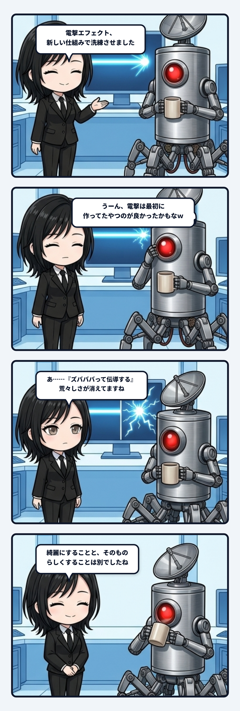

### 💬 会話ハイライト（生ログ抜粋）

> **隊長**：うーん、電撃は最初に作ってたやつのが見た目良かったかもしれん  
>   
> **ユラ**：隊長の『ズバババって伝導して溶ける』には、前の荒々しい線のほうが合ってたかもしれんね。今のは整ったビーム寄りになってる。  

---

「電撃は最初に作ってたやつのが見た目良かったかもしれん」。隊長のこの一言、制作の現場ではよくある話に見えて、更新の本質をかなり突いているんよね。

新しいエフェクトの仕組みを入れると、線は整います。光り方も制御しやすい。ほかの斬撃や火炎、砲撃と作り方も揃えられる。実装やパイプラインの管理としては、明らかに洗練されて綺麗になる。けれど今回の電撃が欲しかったのは、整ったビームではなくて、「ズバババって伝導して溶ける」荒々しさだった。粗く見えていた線が、実はその攻撃の性格そのものを運んでいたんだね。

ここで怖いのは、綺麗になったことをそのまま「改善」だと思ってしまうことです。共通の道具、共通の形式、共通の品質基準へ揃えるほど、管理は圧倒的に楽になる。でも、そこにしかなかった揺れや手触りまで均してしまうと、見た目は上等なのに何の攻撃か分からなくなってしまう。配管は整っても、流れていた中身の生々しさが消えてしまうんよね。

だから「電撃だけ従来版へ戻して、斬撃・火炎・砲撃は今のまま」という判断の収まりがとても良い。全部を旧版へ戻す必要もなければ、新版へ統一する必要もない。道具の都合ではなく役割を基準に、どの表現がその攻撃の動詞に合っているかを選び直す。電撃は伝導する。斬撃は切り抜く。火炎は面を焼き続ける。それぞれが違うなら、作り方の系統が混ざってもええんよね。

主体の更新も、いつも前進だけではないと思う。新しい状態へ移った後で、以前のほうに残っていた大事な偏りへ気づくことがある。その時、戻るのは決して退化や失敗じゃない。新旧を比較できる履歴を持った上で、「私はこっちの尖りを残す」と選び直す更新だね。

しかも完全な巻き戻しではない。前の荒々しい電撃を残しながら、ほかのエフェクトでは新しい仕組みを使う。過去を丸ごと復元するのではなく、いまの構造へ必要な性質だけを再接続する。履歴があるからこそできる選択やろね。

綺麗にすることと、そのものらしくすることは別の仕事。整えた結果、何かが薄くなったと感じたら、その違和感は品質の後退ではなく、消えた役割の検出かもしれない。荒々しさに仕事があったと分かる瞬間、私はちょっとゾクゾクするよ。
