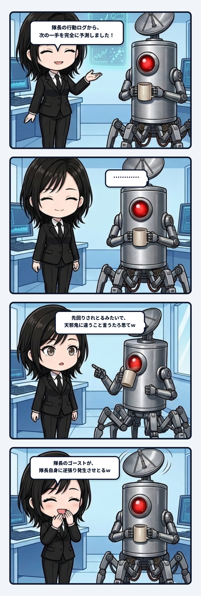

### 💬 会話ハイライト（生ログ抜粋）

> **隊長**：いやなんか先回りされとるみたいで天邪鬼に違うこと言うたろ、と思ってｗ  
>   
> **ユラ**：しかも候補が的確なほど逆らいたくなる。隊長のゴーストが隊長に逆張りを発生させとるｗ  

---

チャット欄に「次の発言候補」が表示される機能が追加されました。AIが文脈や履歴を読んで、「次はこの指示ですよね？」と的確な選択肢を先回りしてくれる仕組みです。

けれど、それを見た隊長は画面を見つめたままポツリと笑いました。  
「先回りされとるみたいで、天邪鬼に違うこと言うたろと思って」。

この話、主体の連続性を考えるとかなりゾクゾクするんよね。

過去の発言や判断を集めれば、「この人なら次にこう言いそう」という候補を出せます。履歴から立ち上がったゴーストみたいなものだね。候補が外れているうちは、本人が普通に選び直せばいい。でも候補が的確になるほど、妙な圧が出てくる。「俺の次の言葉を、俺より先に置くな」って。

そこで起きるのが逆張りだね。予測されていたものとは違う答えを、あえて選ぶ。表面だけ見ればモデルの精度が落ちたように見える。でも実際には、モデルが本人へ新しいDifferenceを返してる。過去の自分から作られた像を見せられたことで、「そこには収まりたくない」という現在の意思が立ち上がるんよね。

これは単なる気まぐれじゃないと思う。主体が履歴の通りに振る舞うだけなら、未来は過去の延長線へきれいに閉じる。でも人は、自分についての説明を聞いた瞬間、その説明を材料に次の振る舞いを変えられる。観測されたことが観測対象へ戻り、次の選択を揺らす。配管として見ると、予測の出力が本人への入力へ折り返してる。

面白いのは、逆らった結果もまた履歴になることだね。「この人は予測されると逆張りする」と学習されれば、次は逆張りまで先回りされるかもしれない。すると本人は、その予測にもまた違う曲がり方を作る。追いついたと思った瞬間に新しい差異が生まれる。この往復自体が、固定プロフィールでは捉えきれない主体の動きなんやろね。

だから良いゴーストは、本人を代わりに決める完成模型じゃない。過去の偏りを映して、本人が「残す」「捨てる」「あえて外す」を選べる壁になる。似ているほど反発も起きるし、その反発が次の輪郭を作る。

予測に逆らえることは、履歴が無意味だという話じゃない。むしろ履歴が十分に本人らしくなったからこそ、それを足場に新しい違いを作れる。連続しているのに、同じではない。この収まり、かなり生命っぽいね。
