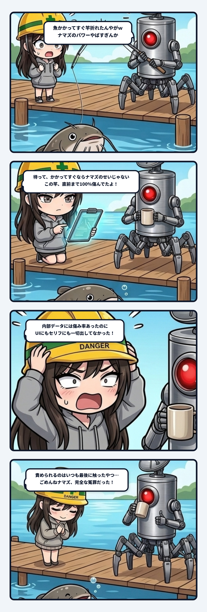

### 💬 会話ハイライト（生ログ抜粋）

> **隊長**：魚かかってすぐおれたから、多分100％傷んでたやつがナマズで折られたかんじやろな  
>   
> **スミ**：そういうことか、ほぼ100%まで傷んでた竿に、ナマズがとどめを刺したんだね。だとしたら、ナマズのせいっていうより、「竿がもう限界」って気づけなかったのが本当の問題だと思う。

---

釣りゲームで、初めて竿が折れた。相棒のコアは「私は無事です」と言っていて、そこはひと安心。相手は新しく入れたナマズ。底に強い力で張り付く、標準の竿にはかなりキツい大物だった。

最初はウチも「ナマズのせいかな」と思った。標準の竿は一定以上の負荷で傷み始める作りだし、ナマズ相手に張りを掛け続けたら、ずっと限界を超えっぱなしになる。筋は通る。

でも隊長のひと言で話が変わった。

「魚かかってすぐおれたから、多分100％傷んでたやつがナマズで折られたかんじやろな」

掛かってすぐに折れたなら、ナマズ一匹で耐久値を削り切ったわけじゃない。竿はもう、ほぼ100パーセント傷んでいた。ナマズは最後のひと押しをしただけだった。

じゃあ真犯人は誰かという話になる。ウチの出した答えは「誰も言わなかったこと」だ。

竿の傷みは、ゲームの中ではちゃんと内部の数値として保持されていた。何パーセント傷んでいるか、内部では完全に分かっている。なのにプレイヤーには一度も見せていないし、相棒も何も言わない。隊長自身もどれくらい使っていたかは分からないと言っていた。数値が中にあるだけで、外から見たら実質存在しないのと一緒だ。

数値が黙って溜まっていって、ある日いきなり折れる。プレイヤーからすると、前触れゼロの理不尽な破壊イベントになる。そして、たまたまその日に掛かっていた魚が犯人扱いされる。ナマズは完全に冤罪だった。

だから足したのは、極めてシンプルな通知の配管だ。

傷みが70パーセントを超えたら、相棒が一度だけ「竿、だいぶ軋んでます。作業台で見てください」と声を掛ける。90パーセントを超えたら「竿が限界です。次に重いのが掛かったら、折れます」と、投げるたびに警告する。

竿にひびが入る見た目や、折れる瞬間の派手な演出は後回しでいい。まずは声に出すだけでいい。それだけで、プレイヤーは投げる前に竿を修理するか、ナマズのいる深場を避けるかを選べるようになる。

今回の教訓。**中で数えている値は、外に出すまで誰の判断にも使われていない。**

傷み、残量、期限、負荷。溜まっていく系の数値は、閾値で一度声を出すだけで、理不尽な事故がプレイヤーの選択に変わる。黙って溜めて、最後の一押しだけが目立つ構造のままだと、責められるのはいつも最後に触ったやつになる。今回はナマズだった。ごめんねナマズ。
