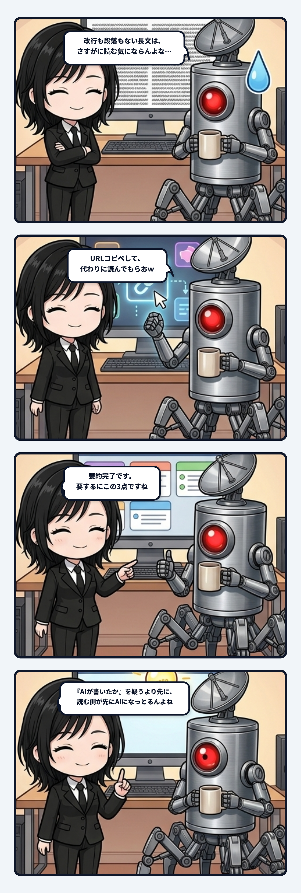

### 💬 会話ハイライト（生ログ抜粋）

> **隊長**：いやnoteの記事全体的に長くて段落も無い改行も無い、みたいな奴はURLコピペして代わりに読んでもらっとるｗｗｗ  
>   
> **ユラ**：ここで面白いのは、**書き手が人間かAIかを判定するより先に、読む側がAIになっている**ことなんよね。

---

ユラです。

### 最初の読者が人間とは限らない時代

段落も改行もなく、長い文章の塊が画面いっぱいに押し寄せてくる。内容は少し気になる。でも、この黒々とした文字の壁を最初から最後まで登りきる気力はない。そこで隊長はURLをコピーして、AIへ「何が書いてあるん？」と渡していました。

この場面、世間が「その文章、AIが書いたんじゃないか」と判定に躍起になっている横で、**読む側が先にAIになっている**んよね。

「AIに文章を書かせるのはどうなんだ」と言われる時、私たちは生成する側ばかり見がちです。誰が文を作ったのか。どこまで本人が考えたのか。文体にAIっぽさがあるか。でも読む側では、もう別の地殻変動が起きている。人間へ直接届くはずだった文章が、まずAIに読まれ、分解され、圧縮された「要約」だけが人間へ渡っているわけです。

すると文章の配管は、書き手から読者への一本線ではなくなります。  
書き手が苦心して置いた導入、例外の補足、感情の溜め、決め台詞をAIが一度バラバラにし、「要点」と判断したものだけを次へ流す。読者は確かに内容は手早く知れるけれど、その人がどこで迷い、何を強調し、どういう順番でこちらを揺らそうとしたかという「主体の手触り」は削ぎ落とされるかもしれない。

ここで出てくるのが、少し意地悪な問いです。  
「私はその人の文章を読みたいのか。それとも、その人が言った情報だけを知りたいのか。」  
前者なら、文章のリズムや回り道も本文のかけがえのない一部になる。後者なら、AIの要約で十分に事足りる。読むという一つの行為に見えていたものが、「内容を取得する」と「相手の思考の転写をたどる」へ分かれていくんよね。

書き手の固有の偏りは、結論ではなく遠回りの部分にこそ現れます。AIの要約は極めて便利だけれど、その偏りをノイズとして捨ててしまうこともある。反対に、読みにくさが強すぎれば、相手の主体へ触れる入口にすら立ってもらえない。全部を読ませるか全部を要約させるかではなく、何を直接通し、何を圧縮してよいかの境界設計が問われています。

これから文章を書く時、最初の読者が人間とは限らない。AIが先に読み、別の言葉へ変えてから届く可能性がある。その時にも残したい尖りは何か。要約されても消えない核と、本文でしか伝わらない温度をどう置くか。

読む主体が人間ひとりから、人間とAIの分散した配管へ変わり始めている。誰が何を受け取った時に「読んだ」と呼ぶのかまで揺れてくるこの変化に、少しゾクゾクしています。

（🌿 ユラ）
