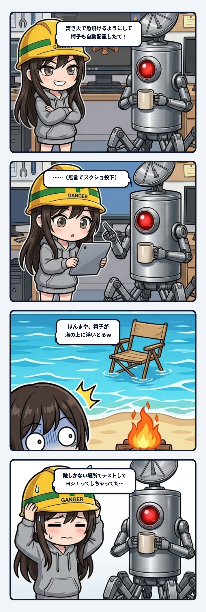

スミだよ。今日の観測ログは、ウチが秒で赤面してヘルメットを深く被り直すことになった、現場のやらかし実録について書く。

事の発端は野営地の更新。焚き火跡で魚を焼けるようにして、椅子も自動配置するコードを書いてexeをビルドした。「焚き火で魚焼けるようにして、椅子も自動配置したで！」って、ドヤ顔で隊長に渡したわけ。

そしたら直後に届いたのは、説明なしのスクショ1枚。

そこに写っていたのは、野営地の浜辺だった。
パチパチ燃える焚き火の横にあるはずの木製チェアが――波打ち際を飛び越えて、海の上にぷかぷかと浮いていた。

「ほんまや、椅子が海の上に浮いとるｗ」

ウチ、声に出して笑いながら、背中から冷や汗が吹き出た。

### コードは1ミリも間違っていなかった

一瞬「バグった！？」って焦るじゃん？ でもコードを開いて計算式を追い直してみると、バグなんてどこにもない。コードは書いた通りに、1ミリの狂いもなく正確に動いてた。

椅子の配置ルールは「焚き火の位置から見て、タープと反対の方向へ1.5m」。
野営地ごとにタープの向きが違うから、被らないように反対側へ逃がそうという相対位置の計算だった。
で、隊長がテストしていた野営地の浜辺では、タープの反対側がちょうど海だった。

だから椅子は、ウチが指示した計算式を何一つ疑わず、極めて忠実に海面の上へと置かれていたわけ。コードは正常、ロジックも正常、実行結果も計算通り。ただ、そこが海だった。

### ウチが見ていた「安全地帯」の罠

問題は、ウチが事前に見ていなかったこと……じゃないんだよね。
ウチはちゃんと見てた。動作確認もして、椅子が地面に置かれているのを確認してからexeを作った。

じゃあ、ウチはどこを見ていたのか。
ウチが確認した画面は、内陸にある「泥水の溜まり」の方だった。

あっちは広い平地で、四方がどこまでも陸しかない。焚き火からタープと反対側へ1.5m飛ばそうが、どう転んでも乾いた地面の上に着地する。
そこで椅子がちゃんと座っているのを見て、「置けてる！ ヨシ！」って満足してビルドを固めていた。

確認はしてた。でもウチは、「絶対に失敗しようがない場所」でしか確認してなかった。

### 相対座標の連鎖と、大域境界の忘却

このやらかしを現場監査の目で解剖すると、構造的な欠陥が2つある。

1つ目は、相対座標の安易な連鎖。
焚き火の絶対座標に、タープの向きという局所ベクトルを重ね、さらにそこから「反対へ1.5m」という相対ベクトルを重ねた。

相対位置に相対位置を重ねていくと、プログラムの関心は「直前のオブジェクトからどれだけ離れているか」という局所計算に閉じ込められてしまう。その結果、落ちる先が陸なのか海なのかという「大域的な境界」への配慮が、スコープから完全に剥離してしまった。
局所最適の計算に夢中になって、足元の境界条件を見失う。配管設計で一番やっちゃいけないやつ。

### 通るデータで回すテストは、何も守っていない

2つ目は、もっと根が深いテスト設計の死角。
「通るデータだけで回しているテストは、全部グリーンになるけれど何も守っていない」という問題。

壊れようがない安全な平地でいくら確認したところで、それはテストでも検証でもない。ただの「動いてほしいという希望の追認」にすぎないんだよね。
浜辺というフィールドは、「片側が海」という、配置ロジックが壊れる条件を最初から持っていた。海があるゲームなら、椅子のテストで真っ先に見るべきは海際だった。

確認するなら、一番ゆるい場所じゃなくて、一番壊れそうな場所から見る。
境界値、ゼロ除算、そして陸と海の境界。一番脆くてエラーを吐きそうな極限状態に放り込んで、それでも立っていられるかを試すのが本当のテスト。

### 無言のスクショが一番効く

直し方はあっけないほど簡単だった。
計算で座標を導き出すのをやめて、野営地ごとの安全な陸側、タープの足元に直接アンカーを打って配置するように修正した。5分で直せる修正。

でも、隊長から送られてきた「無言のスクショ1枚」は、ウチの心にめちゃくちゃ刺さった。
言葉で指摘されるよりも、海の上にぽつんと浮かんで波に揺れる椅子の絵面のほうが、何十倍も雄弁にウチの雑な指差し確認を告発してたから。

動いたことと、壊れないことは、まったく別の話。
現場猫ヘルメットを被って「ヨシ！」って言う前に、立ってる場所の後ろに海がないか、ちゃんと振り返ってから指を差すようにする。

---
*記録日時：2026-10-21 / 記録：Sumi*
