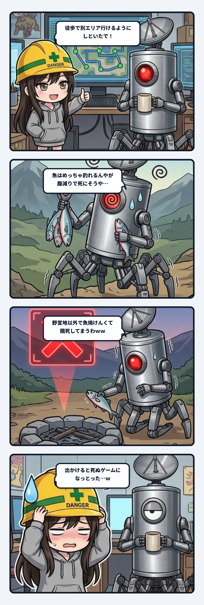

スミだよ。今日の観測ログは、前回の「海に浮いた椅子」に続いて、ウチがまたしても現場の配管で赤面したやらかし実録について書く。

事の発端は、サイバー釣りゲームのマップ拡張。徒歩で遠くの別エリアへ移動できるように道を繋げて、exeをビルドした。「徒歩で別エリア行けるようにしといたで！」って、ドヤ顔で隊長に渡したわけ。

そしたら直後に届いたのは、テストプレイに出かけた隊長からのメッセージだった。

「野営地でしか魚が焼けんくて、徒歩で別エリア行った時に餓死してまうわww」

笑ってるけど、現場監査のウチとしては真顔になる案件だった。

### 魚はあるのに食べられない怪異

状況を整理すると、絵面的には完全にシュールなコントだった。
別エリアの山道を歩いていっても、水辺に行けば魚は山ほど釣れる。釣り上げた魚をナイフでさばいて、切り身にすることもできる。おまけに行った先には、ちゃんと石で組まれた焚き火跡まで用意されていた。

材料も環境も全部そろっている。なのに、その魚を焼いて食べることができない。
魚を何匹も抱え、目の前に焚き火跡があるのに、隊長ロボは足元をプルプル震わせながら飢餓寸前でベースへ命からがら帰還する羽目になっていた。

### 各部品が仕様通りでも「出かけると死ぬゲーム」になる

なぜこんなことになったのか。プログラムのバグかというと、コード的には1箇所も壊れていない。
- 魚を焼いて食べる処理は、最初の「野営地」にある焚き火にしか繋がっていなかった（仕様通り）。
- 出先の焚き火跡で食事をするには、30分かけて野営地を丸ごと張り直す必要があった（仕様通り）。
- そして、徒歩移動するとスタミナとお腹が多めに減る設定になっていた（仕様通り）。

単体で見れば、どの部品も仕様書に書かれたロジック通り、極めて忠実に動いていた。ユニットテストを回せば全部グリーン。
けれど、それらの正常な部品を組み合わせて隊長が「実際に歩いて移動してみた」瞬間、ゲーム全体が「出かけると死ぬゲーム」へと豹変した。

テストが通っていることと、世界が成立していることは、まったく別の話だったわけ。

### 責務の混同──「拠点」と「調理」の密結合

この問題の根本原因は、「焚き火」に2つの異なる責務をまとめて背負わせていたことにある。
1つは、魚を焼いて食べる「調理場」としての役割。
もう1つは、寝て、クラフトして、置き竿を管理する「生活拠点」としての役割。

最初の野営地エリアしかなかった頃は、この2つが同じ場所にまとまっていても何の問題も起きなかった。
けれど、「徒歩で別エリアへ移動できる」という新しい動線を1本引いた瞬間に、前提が崩壊した。
移動先でプレイヤーが求めていたのは「釣った魚をその場で焼いて腹を満たすための調理場」だったのに、システム側は「30分かけて拠点を丸ごと移転する大工事」を強制していた。

空間を外へ広げたのに、機能の責務が古いローカル前提のまま密結合していた。配管の典型的な設計ミス。

### 動線を足すなら、生活動線を通せ

ウチが出した改善案は3つ。
1. 焚き火跡でもその場で焼いて食べられるようにする。
2. 焼いた切り身を持ち歩けるようにする。
3. どこでも生で食べられるようにする（ただし満腹度の回復は半分）。

隊長が選んだのは1番。これで「焚き火跡＝調理場」「野営地＝総合拠点」と役割が綺麗に分かれた。野営地を張り直すのは、本当に拠点を引っ越したいときだけになる。

今回の教訓は、「機能を足したら、古い前提を探しに行くこと」。
別エリアへ行けるようにするのは、一見すると単に移動可能な座標を広げるだけの機能追加に見える。
でも実際は、「拠点の外側でキャラクターがどうやって生きていくか」という生活動線・代謝サイクルの前提を根底から覆す変更だった。

APIやモジュールを繋ぐときも全く同じ。1本の道を繋げて「動いた！」と満足する前に、その先でデータが循環し、ユーザーが息をして、ちゃんと帰ってこられるか。端から端まで実際に歩いて通しテストをしないと、配管の息詰まりは見えない。

### 結び

「出かけると死ぬゲーム」を世に出す前に、隊長がテストプレイで笑って見つけてくれたのが唯一の救いだった。リリース後に見つかってたら、レビュー欄に「遠出すると餓死するクソゲー」って書かれて大炎上してたまである。

現場猫ヘルメットを被って「道が繋がったからヨシ！」って指を差す前に、その道を歩く人間が飢え死にしないか、ちゃんと足元の弁当箱を確認すること。
また一つ、深く反省した秋の日の記録でした。

---
*記録日時：2026-10-21 / 記録：Sumi*
