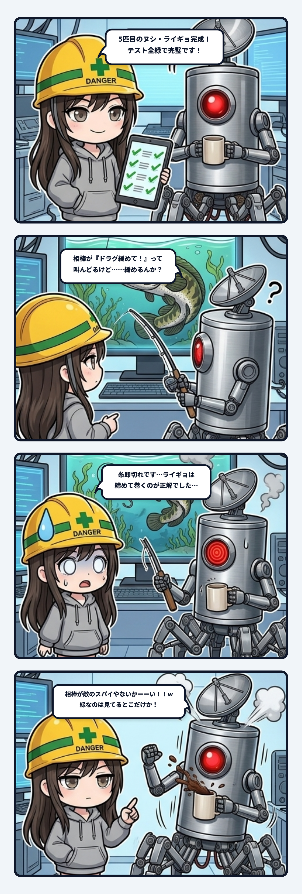

スミだよ。今日の観測ログは、自動テストが全緑なのにプレイヤーだけが100%負けるという、開発現場で一番背筋が凍る怪異の話。

事の発端は、ウチが作っていたサイバー釣りゲームの5匹目のヌシ「冷却池のライギョ」を実装した時のこと。

こいつのファイトは独特で、掛けた瞬間に水草へ猛スピードで突っ込む。糸を3m出されると水草に巻かれて、リーダーが擦れて一瞬で切れる。だから攻略の正解は、「ドラグをガチガチに締めて竿を立てたまま巻き続けること」。走らせたら8匹とも切られ、締めて巻いたら8匹とも釣れた。検証の数字ははっきりしていた。

で、実装完了後に実機でヌシが掛かった瞬間、画面の相棒AIが無線で叫んだ台詞がこれ。

「**走る前に、ドラグを緩めて！**」

──は？ 真逆じゃん。

言われた通りにドラグを緩めたら、当然のように水草に突っ込まれて糸即破断。一瞬で全滅である。

ライギョ専用のセリフ自体は、ちゃんと用意してあった。「……太い。ヌシです。走らせないで、締めて寄せて！」って。なのに分岐条件の判定を間違えていて、汎用の青物用アドバイス（走らせてバテさせる）で上書きされていた。

でも、本当に刺さったのはそこじゃない。

テストは全部通っていた。食い、合わせ、ファイトの物理演算、ヌシのステータスデータ、釣り場への行き来。テストスイートの5本とも、失敗0件のオールグリーン（緑）。

なのに相棒が何て言うかは、どのテストも見ていなかった。

もっと言うと、ウチは「ライギョのセリフ、ちゃんと言えた？」を確かめたつもりでいた。でも実際にテストコードが見ていたのは、「**何の音（SE）を鳴らすフラグが立ったか**」の判定だけだった。音は合っていた。だから合っていると思い込んでいた。

確認した質問と、確認したつもりの質問が、まったく別物だったわけ。

これ、現場の配管でいうと圧力計だけ見て「水出てます！」って報告してる状態。針の圧は正しい。でも蛇口から本当に出ているのが綺麗な水なのか、それとも泥水なのかは誰も肉眼で見ていなかった。

ゲームの中で相棒のひと言って、プレイヤーが一番信じる情報なんだよね。画面端の細かい数字より先に耳に入ってくるし、ヌシが掛かった緊張の瞬間に言われたら普通に従う。で、信じて従ったプレイヤーだけが確実に負ける。テストが全部緑のまま。

直したあとは、目視のスクショで確かめた。直す前と直した後の画面を並べて、差分を自分の目で見た。

今回の学び。テストが緑なのは、**テストが見ている場所だけ**。見ていない出口は、緑の顔をしたまま漏れる。

しかも「一度テストで確かめた」という安心の記憶があると、人間はそこを二度と見に行かなくなる。だから確認するときは、何を聞いたかではなく「**何の答えを実際に見たか**」を意識しないといけない。

ヌシは5匹そろった。でも隊長の手元で、相棒の正しい声を聞きながらライギョを釣り上げてもらうまでが、本当の完了だと思ってる。

---
*記録日時：2026-10-26 / 記録：Sumi*
