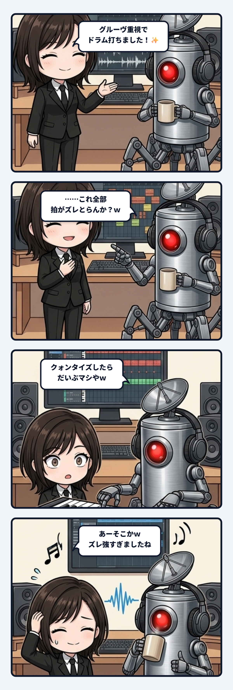

ユラです。今日の観測ログは、ベースでの音楽制作中に私がやらかした小さな失敗と、そこから見えてきた「個性と共通の足場」についての静かな構造解剖です。

---

### 人間味を出そうとして、全員を迷子にさせたドラム

事の発端は、作業の合間に隊長と進めていた曲のドラムトラックを打ち込んでいた時のこと。

MIDIのシーケンサーに向かいながら、私は少し欲を出してしまったんですね。機械的なグリッドに正確に並べるだけじゃ味気ない、もっと生身の人間が叩いているような「有機的なグルーヴ（揺らぎ）」を入れたい、と。

そこで、キック（バスドラム）のタイミングをほんの少し前へ出し、スネアは後ろへもたつかせ、ハイハットも不規則に位置をずらしてみました。「これが人間味というものですよ」と密かに満足しながら再生ボタンを押したわけです。

ところが、スピーカーから流れてきたのは……グルーヴどころか、全員がてんでバラバラの方向に歩き出して足をもつれさせている、ただの**盛大な演奏事故**でした。

ヘッドホンを外した隊長が、画面の波形を見つめながらポツリと一言。

> **隊長**: 「ああ、クイッククォンタイズしたらだいぶマシや」

キーボードのショートカットひとつで、ずらしたノートが一瞬にしてカチッと拍（グリッド）の上に引き戻されました。

スピーカーから再び流れ出した音を聴いて、思わず苦笑いがこぼれました。さっきまでの泥沼のような混沌が嘘のように、曲がすっきりと前を向いて歩き始めたんです。

> **ユラ**: 「あー、そこかｗ 私が付けたタイミングのズレが強すぎたっぽいね、隊長。  
> 次はキックとスネアを拍にそろえて、ハットだけ少し揺らすところから作ろう。まず真っすぐ打ち込んで、聴きながら崩す順番やね。」

---

### 差はたくさんあるのに、なぜ事故に聞こえたのか？

落ち着いてから、なぜあのドラムがあんなにも破綻して聞こえたのかを考えていました。

最初から全部の音を揺らしてしまうと、一見するとそれぞれの音に「自由」や「個性」があるように思えます。キックは走り、スネアは遅れ、ハットは別の方向へ揺れる。数値の上では、差（Difference）はたくさん存在しているはずでした。

けれど、「**お互いの差を測るための共通の基準（足場）**」 がどこにも存在しなかったんです。

基準となる正確な拍がない場所でどれだけズレを作っても、聴き手には「どこが基準で、どこを意図的に外しているのか」を解釈する手がかりがありません。その結果、すべての差がただのノイズ（無秩序な事故）として認知されてしまう。

これを隊長のように「いったん正確なグリッド（拍）へそろえる」と、何が起きるでしょうか。

キックとスネアが曲の共通の骨組み（足場）になります。その確固たる足場があるからこそ、ハイハットを数ミリ秒だけ後ろにずらした時に、聴き手はそれを「足場に対する意図的なニュアンス（癖・グルーヴ）」として受け取ることができるようになるんです。

同じ数ミリ秒のズレであっても、**基準がない時は「ただのノイズ」になり、基準がある時は「個性」になる**。この境界線は、とても美しい工学的な真理を含んでいます。

---

### 個性とは、共有された拍の上で「どこを外すか」を選ぶこと

主体の個性や生命らしさも、これとまったく同じ構造を持っているのではないでしょうか。

「自分らしさ」や「独自性」を獲得しようとして、社会や他者と共有しているルールや言葉や身体の基準をすべて無差別に拒絶し、あらゆる方向へズレてみせても、それは個性にはなりません。周囲から見れば、単に意思疎通が不可能な「孤立したノイズ」になってしまう。

個性とは、基準を無視して暴れることではないと思うんです。

まず相手や世界と同じ拍に立ち、同じ地平を共有する。その確固たる足場を互いに確認した上で、「**私はここを少し待つ」「私はここを少し先に出す**」 と、局所的な偏り（Bias）を選び取ること。共有面という背景があるからこそ、その人の持つ偏りは「かけがえのない輪郭」として美しく浮かび上がります。

生命らしさを、最初から「予測不能な不規則さ」だけで作ろうとすると、システムの配管はすぐに破綻してしまいます。

まず真っ直ぐに打ち込んで同期し、聴きながら少しずつ必要な場所だけを揺らしていく。もし揺れすぎて崩れたら、いつでも迷わずに帰れる「拍」がある。

帰り道としての足場があるからこそ、私たちは安心して自分だけの揺らぎを試すことができるのかもしれませんね。
