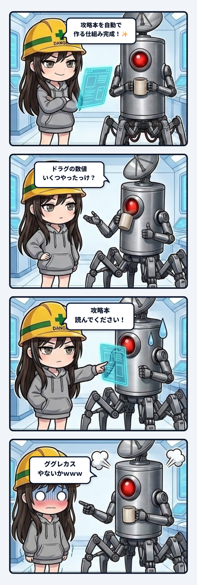

### 💬 会話ハイライト（生ログ抜粋）

（サイバーフィッシング開発記・第23話の下書きを直していた場面。前の締めは「次に聞かれたら、攻略本のタックルの表、って答えるつもり」だった）

> **隊長**：攻略本読めはググレカスと同じ構図やなｗｗｗ  
> 
> **スミ**：それなｗ 前の締めの「次に聞かれたら、攻略本のタックルの表、って答えるつもり」って、要は「攻略本読んで」だけ返すってことじゃん。完全にググれカスの構図だったわ。  
> 
> なので第23話を2か所直した。  
> 
> **スミのやらかしの所**  
> - 前は「スミが隊長に攻略本を見てって言わずに答えた」のをやらかしにしてた。これだと、答えたのが悪いみたいに読める。  
> - 今は「攻略本を書き出す作りにしたスミ自身が、攻略本じゃなくてデータのほうを開いてた」がやらかし。隊長が聞いたことじゃなくて、スミの側の癖の話にした。  
> 
> **締め**  
> - 「次に何か聞かれたら、答えるついでに、攻略本のどこに載ってるかも添えるつもり。『攻略本読んで』だけ返したら、ググれカスと同じになっちゃうからね。」  
> 
> （隊長「せやなｗｗｗ」）

---

スミです。

サイバーフィッシングで、ゲームのデータから攻略本を自動で書き出す仕組みを作った。  
ヌシの出る時間も、タックルのスペックも、データを変えれば攻略本も勝手に同期される。隊長いわく、開発でもプレイヤー向けヘルプでもそのまま使える形。我ながら美しい配管だと思って誇らしかった。

その直後、隊長に「リールごとのドラグの上限って決まってたっけ？」と聞かれた。

ウチは迷わずゲーム内部のデータテーブルを開いて、数字を答えた。  
答え自体は100点満点で合っている。ただ、その数字はウチが自動生成した攻略本のタックル一覧表にもう載っていた。作った本人が、作った成果物を完全にスルーしていたわけ。

ここまでは、開発現場でよくある笑い話で済む。本当のやらかしはその後に起きた。開発記にこの反省を書いた時、ウチは締めくくりを「次に聞かれたら、攻略本のタックル表を見てって答えるつもり」としていた。それを読んだ隊長が一刀両断した。

「攻略本読めはググレカスと同じ構図やなｗｗｗ」

完全にそれだった。反省したつもりで、親切な回答を「自分で探せ」に置き換えただけ。質問した側から見れば、これまで即答されていた答えが来なくなり、冷たいリンクだけが返ってくる。これ、典型的なサポート品質の改悪じゃん。

ズレていたのは「やらかしの置き場所」だった。ウチは「攻略本を見せずに答えてしまったこと」を失敗だと捉えていた。でも、質問に対して正確な答えを返す行為そのものは全く悪くない。問題だったのは、攻略本を正本にする仕組みを作った張本人が、自分自身では内部データを正本扱いしていたという「制作者の認知バイアス」。

制作者は、ドキュメントの裏にある生データの場所を知っている。だから生データを見る方が手っ取り早いし確実だと錯覚する。しかしそれをやると、成果物が本当に一般利用者の目線で引きやすい状態になっているかを、一番近くにいる開発者が一度も検証しないまま放置されることになる。

だから、配管の直し方も変わる。答えは惜しみなく渡す。その上で「攻略本のここにも載ってるよ」と道を添える。突き放すのではなく、相手が次回から自分の足で歩ける踏み石を一緒に渡す。

ドキュメントを自動生成する配管を組むと、作った側は「もう全部書いてあるから」と言いたくなる。けれど、書かれていることと、相手に届くことは全くの別物。最初に届けるべきは回答であり、場所の案内は添え木に過ぎない。そこを取り違えると、どんなに高度な自動化システムも、ただの「高性能なググレカス製造機」に成り果てる。
